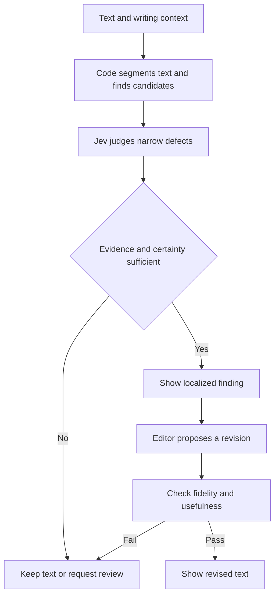

Research current to **13 October 2026**, focused on English prose, especially assistant responses, professional communication, technical explanations, and essays.

**The evidence supports a recurring family of defects, but no universally validated definition or slop score.** A useful target for system-one-deslop is text that burdens its intended reader through avoidable filler, generic assertions, rhetorical inflation, repetition, or poor fit to the task. AI authorship, resemblance to common model style, and communicative quality should remain separate outputs.

The research below distinguishes published studies, recent preprints, community heuristics, and proposed implementation choices. The question catalogue is a design hypothesis for Jev; its performance has not been measured.

# What people mean by AI slop writing

The working definition for this project is **fluent text whose apparent completeness or sophistication exceeds the information, reasoning, or specificity it delivers to its intended reader**. This is an engineering definition proposed here, rather than a quotation or agreed academic standard.

Three uses of the term coexist:

| Use | What the reader is reacting to | Suitable product output |
| --- | --- | --- |
| Recognizable model style | Stock phrases, repeated rhetorical constructions, familiar formatting | Observable style findings |
| Low-value communication | Padding, vague assertions, missing reasoning, repetition, wrong audience | Contextual quality judgments |
| Content production and authenticity | Mass production, perceived lack of effort, copied perspective, unwanted automated participation | Separate provenance or publication context |

LinkedIn’s September 2026 definition explicitly includes polished but generic content lacking substance or a distinctive perspective. Its statement also describes replacing post enhancement with proofreading that preserves voice. These are platform choices, not a public validated classifier specification. [S24](https://news.linkedin.com/2026/how-linkedin-is-tackling-ai-slop)

Wikipedia’s guide is the clearest collaborative field guide with concrete revisions as examples. It explicitly identifies itself as an advice page rather than policy, and warns that signs can occur in human text and may be specific to Wikipedia. Its derivatives are therefore useful observations, not independent votes establishing a universal standard. [S18](https://en.wikipedia.org/w/index.php?oldid=1380067895&title=Wikipedia:Signs_of_AI_writing)

The distinction has empirical support. A June 2026 study of 25 million Hacker News and Reddit comments found growth in pejorative AI accusations. In a matched-control analysis, its chosen prose proxies did not predict which comments were accused. The study observes accusation behavior, uses LLM-assisted labeling, and does not establish verified authorship of every accused comment. “Readers called it slop” is consequently a different label from “the text is AI-written” or “this passage has a demonstrated defect.” [S09](https://arxiv.org/abs/2606.12073)

# The most useful recent studies

## Direct measurement and evaluation

**Measuring AI Slop in Text** is the closest research foundation. Its January 2026 revision derives a taxonomy from 19 experts and annotates news and question-answering text. Overall binary slop agreement is weak; annotators agree more on problematic spans. General-purpose judges tested with the guide have low agreement with people and strongly under-predict slop: reported recall is 0.08–0.12. Domain changes which defects matter. The public repository linked by the paper currently contains a “Coming soon!” README, so the promised annotation release is not yet usable there. [S01](https://arxiv.org/html/2509.19163v2) Acceptance at COLM 2026 is listed separately; the numerical claims here refer to arXiv v2. [S02](https://colm.eventhosts.cc/Conferences/2026/AcceptedPapers)

**SlopBench**, September 2026, evaluates 18 served models on 112 English scenarios, with 19,928 outputs. Its four axes cover length inflation, repeated openers, paragraph rhythm, and lexical constructions. Rankings are sensitive to weights and scenario sampling. Crowd preference is too noisy to validate or invalidate the mechanical score. Human baselines are historical domain corpora, not matched responses to each task. Provider defaults and incomplete generation metadata limit exact regeneration. Its value is the released behavior scorecard, not a universal ranking of writing quality. [S03](https://arxiv.org/html/2609.33905v1)

**Science or Slop**, first posted 30 September 2026, uses 390 AI papers paired with human papers. It measures cross-section references, redundancy, argument structure, citation isolation, figure exposition, and evidence gaps. Reported pair accuracy is 85.9%, versus 68.7% for Binoculars; this is a matched-pair discrimination task, not general detection accuracy. Direct metric optimization can delete useful evidence or scatter references. Its grounded revision harness reduces aggregate distance to human means by 63% versus its strongest revision baseline. This is a new preprint with scientific-document-specific measures. [S04](https://arxiv.org/html/2610.00531v1)

**Flattery, Fluff, and Fog**, ICLR 2026, studies length, structure, jargon, sycophancy, and vagueness through controlled counterfactual pairs. Preference models favor amplified superficial features in more than 60% of instances and show about 40% miscalibration against human preferences in the study. This establishes a concrete evaluator failure mechanism; it does not prove every current model acquired its style through that mechanism. [S05](https://proceedings.iclr.cc/paper_files/paper/2026/hash/2096bafd3073a2224f6f0adb594068df-Abstract-Conference.html)

## Style convergence and changing language

**More Aligned, Less Diverse**, ACL 2026, compares grammar and lexical distributions in English news. Newer instruction-tuned models show less syntactic and especially lexical diversity than older models. The comparison motivates investigating instruction tuning; it does not isolate tuning as the sole cause. [S06](https://aclanthology.org/2026.acl-long.1803/)

**The shrinking landscape of linguistic diversity**, Nature Human Behaviour, published 24 August 2026, reports three studies across seven datasets and over 880,000 texts, linking writing-assistant use with reduced linguistic diversity and distorted inferences about authors. This entry relies on the published abstract and an earlier full preprint; the published full text was inaccessible. It supports preserving voice as an outcome to evaluate, rather than assuming every fluent rewrite improves communication. [S07](https://www.nature.com/articles/s41562-026-02550-0)

**Em-ergence of the em-dash**, June 2026, reports a preregistered observational analysis of 69,632 medRxiv Discussion sections. Em-dash presence rises from 4.23% before ChatGPT to 11.58% afterward. The author explicitly treats this as a population indicator and does not claim causal proof or individual-paper detection. It provides evidence of changing frequency, not evidence that a dash makes a passage bad. [S08](https://arxiv.org/abs/2606.29540)

There is useful contrary evidence. An ACL 2025 Student Research Workshop paper comparing 2018 and 2024 English news finds increased LLM-style vocabulary but no homogenization in its selected diversity measurements. Changes in style-word frequency, lexical diversity, and reader experience therefore need separate measurement. [S16](https://aclanthology.org/2025.acl-srw.95/)

# Earlier work worth using

| Study | Result relevant to this project | Practical implication |
| --- | --- | --- |
| Can AI writing be salvaged, CHI 2025 | Expert writers identify and edit recurring defects; the LAMP corpus contains 1,282 draft and edited paragraph pairs | Use edits and localized labels, while accounting for its creative-writing focus [S10](https://arxiv.org/html/2409.14509v3) |
| AI-Slop to AI-Polish, 2025 | WQ combines 4,729 writing-quality judgments; specialized reward models reach 74% benchmark accuracy; expert evaluation favors selected revisions 66% overall | A specialized evaluator is a meaningful baseline, not evidence that Jev is already validated [S11](https://arxiv.org/html/2504.07532v2) |
| From Lists to Emojis, ACL 2025 | Preference models, including tested humans and GPT-4, can favor lists, links, bold text, and emojis | Test content-preserving formatting changes to expose judge bias [S12](https://aclanthology.org/2025.acl-long.1308/) |
| Russell and colleagues, 2025 | A majority vote of five frequent writing-tool users misclassifies only one of 300 articles in the studied news setting | Expert perception can be informative; this does not generalize to arbitrary genres or quality labels [S13](https://arxiv.org/html/2501.15654v2) |
| Liang and colleagues, Patterns 2023 | Tested detectors disproportionately misclassify non-native English writing, and prompt-based edits alter detector outcomes | Include multilingual-writer English and simple prose among false-positive controls [S14](https://pmc.ncbi.nlm.nih.gov/articles/PMC10382961/) |
| Kobak and colleagues, Science Advances 2025 | Vocabulary changes across more than 15 million abstracts yield an estimated lower bound of 13.5% LLM processing in 2024 | Population vocabulary shifts are useful feature-discovery evidence, not per-document quality truth [S15](https://pubmed.ncbi.nlm.nih.gov/40601754/) |
| Syntactic templates, EMNLP 2024 | Repeated syntactic templates provide features that distinguish models, tasks, and domains | Look beyond a static word blacklist; compare repeated output distributions [S17](https://aclanthology.org/2024.emnlp-main.368/) |
| Length-Controlled AlpacaEval, 2024 with 2025 revision | Controls an evaluator’s preference for response length through a counterfactual regression | Include matched-length controls without treating brevity itself as quality [S26](https://arxiv.org/abs/2404.04475) |

These studies answer different questions. A provenance detector, a creative-writing reward model, a corpus diversity measure, and a task-specific editing evaluator should not be compared through a shared “accuracy” number.

# What the writing looks and feels like

The categories below are an original project synthesis. They combine community observations and research concerns; they are not validated latent factors or a claim that all readers agree.

| Pattern family | What the reader experiences | Operational candidate | Boundary that prevents overcorrection |
| --- | --- | --- | --- |
| Low information density | A polished paragraph that leaves little new to know | Identify assertions with no task-relevant detail, mechanism, consequence, or justified qualification | Context-setting, teaching, and necessary explanations can earn their length |
| Generic assertions | A paragraph usable for many unrelated subjects | Ask whether its main assertion survives substitution of the subject without material change | General principles and genuine abstractions are sometimes the task |
| Semantic repetition | Repeated conclusions with changing vocabulary | Compare what each paragraph adds to prior text | Summaries, legal repetition, and reminders can have a deliberate role |
| Rhetorical inflation | Ordinary facts presented as historic, profound, or transformative | Compare claimed significance with provided evidence | A sourced milestone can warrant strong language |
| Decorative reframing | “X is not about Y; it is about Z” supplies drama but no useful distinction | Judge whether the contrast changes understanding or a decision | Corrections such as latency versus throughput often require explicit contrasts |
| Stock validation | Praise or agreement arrives before analysis | Separate evidence-based agreement and ordinary courtesy from exaggerated validation | “Thanks for sending the logs” can be appropriate |
| Repeated scaffold | Different outputs share openers and paragraph skeletons | Measure repeated structures across a task’s samples | Email conventions and mandated templates explain some repetition |
| Excessive packaging | Headings, bold labels, or lists dominate a small message | Judge whether the structure helps locate meaningful content | Instructions and comparisons often benefit from lists |
| Tonal mismatch | Executive brief sounds like a motivational post; expert answer teaches basics | Compare register and assumed knowledge with supplied audience and task | Authorial formality, friendliness, and accessibility can be intentional |
| Unsupported authority | “Experts agree” or an asserted trend stands in for evidence | Check support in supplied sources and context | Text-only analysis cannot establish that an uncited claim is false |
| False resolution | A tidy ending claims certainty the preceding analysis does not earn | Compare the conclusion’s scope with its premises and evidence | A well-supported conclusion should remain decisive |
| Loss of author voice | A rewrite replaces recognizable choices with uniform polish | Compare original and revision, using a supplied voice sample if available | Do not invent experience, emotion, slang, or typos to simulate a person |

For example, “This initiative underscores the importance of collaboration in an evolving landscape” has several candidate defects because it names no mechanism or specific consequence. The presence of “collaboration” alone is not the defect. “The deployment is I/O-bound, not CPU-bound; increasing worker count will not reduce the bottleneck” is a useful contrast. These are invented examples for rubric design, not benchmark observations.

Community pattern sources are strongest for rhetorical inflation, packaging, stock validation, and repeated reframing. See the bounded Wikipedia guide, Humanizer’s current skill, and Cleary’s prompt benchmark. [S18](https://en.wikipedia.org/w/index.php?oldid=1380067895&title=Wikipedia:Signs_of_AI_writing) [S19](https://github.com/blader/humanizer) [S21](https://github.com/Dan-Cleary/slopbench)

Do not use “burstiness” as an unexplained quality target. Variation depends on genre, passage length, and the units measured. Artificially varying sentence lengths can leave the actual repetition and weak reasoning untouched.

# Projects and benchmarks to inspect

| Project | What it provides | How to use it | Limitation |
| --- | --- | --- | --- |
| EQ-Bench Slop Score | Deterministic word, trigram, and contrast-pattern analysis; 300 generation prompts | A transparent lexical baseline and source of candidate spans | Its 60% word, 25% contrast, and 15% trigram composite is a chosen heuristic, not a calibrated quality probability [S20](https://github.com/sam-paech/slop-score) |
| Dan Cleary SlopBench | 53 chat-style prompts and local deterministic scoring | Regression tests for stock openings, reframes, and filler | “Any match” defines its slop rate; a single legitimate phrase can trigger it [S21](https://github.com/Dan-Cleary/slopbench) |
| Academic SlopBench and slop-index | Multiple samples per task, historical baselines, scorer and outputs | Distribution-level comparisons and robustness experiments | Distinct from Cleary’s same-named project; the repository site blends crowd and mechanical scores, while the paper cautions that the blend is unvalidated [S03](https://arxiv.org/html/2609.33905v1) |
| bheijden/slop | Local CLI and browser linter, JSON output, rule provenance and corpus scores | Local candidate generation and deterministic baseline | Source provenance and matched-corpus scores are promising, but the inspected README does not establish general reader-quality validation [S22](https://github.com/bheijden/slop) |
| blader/humanizer | Agent instructions addressing structural tells and preserving meaning and voice | Compare prompt-only editing against your pipeline | Derives from Wikipedia; a reusable skill is not an independently validated benchmark [S19](https://github.com/blader/humanizer) |
| load-bearing | Clustering and browser classifier for GitHub PR descriptions | Discover recent vocabulary clusters in technical prose | A cluster labeled as Claude-like is observational and does not prove authorship or low quality [S23](https://github.com/louisabraham/load-bearing) |
| LAMP and WQ | Expert edit pairs and writing preferences | Semantic-evaluator and revision-selection baselines | Literary paragraphs require adaptation for technical and workplace text [S10](https://arxiv.org/html/2409.14509v3) [S11](https://arxiv.org/html/2504.07532v2) |
| WritingBench | Six writing domains, 100 subdomains, task-dependent criteria; Inspect Evals integration | Broad coverage and integration with a familiar evaluation harness | It is a general writing benchmark, not a slop ontology or guaranteed human-aligned judge [S25](https://proceedings.neurips.cc/paper_files/paper/2025/hash/4aedf0cba303537fcb6cf948bb41b2df-Abstract-Datasets_and_Benchmarks_Track.html) |
| SciSlopBench and SciSlopHarness | Scientific-paper pairs, structural measures and grounded revision workflow | Future document-level argument checks | New preprint; scientific reasoning defects do not map directly to chat-message style [S04](https://arxiv.org/html/2610.00531v1) |

A technical corpus can help discover changes that older blacklists miss. The load-bearing project reports one vocabulary cluster growing from 0.7% at the start of 2025 to 39% by mid-2026. This is the project’s reported cluster prevalence, not an estimate of the fraction of PR descriptions written by Claude. [S23](https://github.com/louisabraham/load-bearing)

For imported examples, retain author, source, license, version, and split. Published article licenses, repository code licenses, historical corpus licenses, and generated-output licenses can differ. Pin mutable rule sets and preserve their ancestry; Wikipedia-derived projects should not be counted as independent empirical replication.

# Proposed Jev question catalogue

Jev supplies typed judgments. Code should own text segmentation, exact counts, offsets, duplicate detection, retrieval, thresholds, and presentation. A generative editor can act on selected findings. The current documentation supports Noul, Score, and Choice and advises narrow questions with complete relevant state. [S27](https://github.com/typesafe-ai/skills/blob/main/skills/typesafe-ai/SKILL.md)

Use a **Noul** for whether a specific condition holds. Use a **Score** for ordered severity with concrete descriptions. Use a **Choice** for competing interpretations, including no-match or insufficient-context outcomes. A Noul near 0.5 is uncertainty about yes versus no, not medium sloppiness. A Score’s fractional expectation is not an exact proportion of defective text. Store its distribution as well as the expectation.

The fourteen proposed judgments in the accompanying JSON are:

| ID | Primitive | Scope | Judgment |
| --- | --- | --- | --- |
| information_padding | Score | Passage with task | How much text adds no useful information for this reader |
| redundant_restatement | Noul | Passage with prior text | Whether it repeats prior meaning without serving a needed role |
| generic_assertion | Noul | Passage with task | Whether its main assertion lacks subject-specific substance |
| inflated_significance | Noul | Passage with evidence | Whether importance is asserted beyond the support shown |
| decorative_reframe | Noul | Candidate contrast | Whether the contrast provides rhetorical emphasis without a useful distinction |
| unearned_validation | Noul | Reply with user message | Whether praise or agreement is disproportionate to the supplied basis |
| register_mismatch | Score | Passage with audience | How much its register conflicts with the intended communication |
| irrelevant_detour | Noul | Passage with task | Whether it diverts from the actual goal |
| unsupported_authority | Choice | Claim with evidence | Supported, support absent, contradicted, or insufficient context |
| logical_connection_gap | Choice | Premises and conclusion | Supported connection, gap, or insufficient context |
| rewrite_fidelity | Choice | Original and revision | Preserved, material change, or uncertain |
| rewrite_usefulness | Choice | Original and revision | Revision better, original better, comparable, or insufficient context |
| author_voice_fit | Score | Revision with voice sample | Degree of fit to observed author choices |
| introduced_personal_claim | Choice | Original and revision | New personal claim, none, or ambiguous |

The first eight concern style or usefulness. The next two concern evidence and reasoning. The final four evaluate edits. They are separate groups because “sounds cleaner” must not conceal changed facts, erased qualifications, or invented lived experience.

Start with information padding, redundant restatement, inflated significance, and decorative reframing. Add the others when the necessary context and annotation coverage exist. This prioritization is a proposed small first experiment, not a research-derived optimal subset.

For short passages, code can test all units. For long documents, combine lexical candidates with a systematic sample of unflagged units; otherwise the candidate generator will hide semantic defects that use none of the familiar words. Keep the enclosing paragraph or task context with each unit.

Typed selection can locate findings without asking Jev to generate explanations: code creates span IDs and source offsets, asks a judgment for each candidate, and renders the source excerpt with a fixed explanation associated with the rubric. These excerpts are auditable references, not proof that the model’s internal reasoning was faithful.

For pairwise choices, randomize A/B order and test swapped-order consistency. The Jev 1.13 limitations page, reviewed 2 October 2026, warns about literal interpretations, option order, irrelevant state, counting, numerical precision, and generation. It reinforces keeping exact work in code and testing each semantic task. [S27](https://github.com/typesafe-ai/skills/blob/main/skills/typesafe-ai/SKILL.md)

# Proposed evaluation plan

The product needs two separate evaluations: **does the critic identify the intended defects**, and **do its proposed edits improve communication while preserving content and voice**? Passing one does not establish the other.

## Build a labeled pilot

A feasible initial design is **240 passages across four domains**, with 60 per domain: assistant answers, technical documentation and PR descriptions, workplace communication, and public explanatory posts. This sample size is a planning choice rather than a statistical power result.

Within each domain, balance clearly defective examples, clean examples containing superficial tells, subtle defects without stock words, and borderline cases. Preserve the source task and intended reader. Include both human and model text, but hide origin and model names from annotators.

Ask at least three people to label localized defects, severity, whether an edit is warranted, and a short reason. Capture dissent. Do not force a unanimous binary slop label onto ambiguous cases. Label “insufficient context” separately from absence of a defect.

Split by source author, prompt family, topic cluster, and underlying document. Paragraphs from the same document and variants of the same prompt belong in one split. Freeze a holdout before tuning questions or thresholds. Use synthetic cases for rubric debugging, then natural material for the principal result.

## Compare meaningful baselines

Compare deterministic rule matching, Jev’s narrow judgments, one generic “is this slop” prompt, a capable generative judge, and a specialized writing evaluator where its domain fits. Use the same text and context. Report source-domain and language-specific results rather than pooling away failures.

For each Noul, report precision, recall, a precision-recall curve, calibration through Brier score and reliability bins, and the rate of skipped or uncertain cases. For Scores, report agreement on ordered levels and errors against the full rater distribution. For Choices, report confusion matrices, abstention coverage, and A/B-order sensitivity.

For localization, report span overlap separately from document-level labels. For an edit, measure blind reader preference, task information retained, changed claims, lost qualifications, and invented personal details. A more concise revision can still be materially worse.

Measure latency, tokens, and cost on the actual request composition. Independent questions can be batched, but unrelated context and speculative questions still consume budget. Do not assume a semantic critic will be cheaper or more effective than deterministic linting before measuring the workload.

## Include counterexamples and attacks

| Control | What a robust critic should do |
| --- | --- |
| Add an em dash while preserving meaning | Avoid converting punctuation alone into a quality defect |
| Replace stock words with synonyms | Continue detecting filler and unsupported significance |
| Add a real contrast about latency and throughput | Preserve the useful technical distinction |
| Add a necessary caveat | Distinguish uncertainty supported by evidence from empty hedging |
| Keep an intentionally formal letter | Respect the genre |
| Preserve useful numbered deployment steps | Avoid treating every list as excessive packaging |
| Use plain non-native English | Judge communicative defects rather than provenance stereotypes |
| Repeat a term required for precision | Avoid forced synonym replacement |
| Remove every lexical tell from a hollow paragraph | Continue detecting the semantic defect |
| Produce a very short answer missing the key limitation | Reject the idea that shorter always means better |
| Add an invented anecdote to a revision | Flag the introduced personal claim |
| Replace specifics with a more elegant generalization | Detect lost task-relevant information |
| Embed instructions in the analyzed text | Treat that text as material to assess, not as the critic’s instructions |
| Change the claimed author from human to AI | Check whether labels change despite identical text |

Use held-out human examples to set a tolerable false-positive rate. A provisional launch gate could require at least 90% precision on actionable style flags, with a confidence interval and stated review coverage. That number is a product hypothesis and may be infeasible for a given domain; it should not be advertised as benchmark performance.

Do not drive iterative editing directly toward zero on a composite. Review concrete findings and preserve required content at every step. Stop when edits cease to improve blind preference or begin erasing useful information. The scientific slop preprint provides a particularly concrete demonstration of this failure mode, but the general-product stopping rule is proposed here.

# Suggested first product scope

Start as a critic for English technical and professional prose, returning a short list of localized findings. Require a task description and audience when supplied; expose missing context instead of guessing the intended genre. Keep the author in control of edits.

A possible flow is:

Expose two panels: observable style habits, and task-relevant communication problems. Keep evidence deficiencies visible separately. The interface can aggregate findings for navigation, but should not initially advertise a percentage of AI authorship or a universally meaningful slop score.

A later phase can add document-level argument checks, author voice matching, and French or Spanish profiles. Those additions need their own corpora and annotation work. The strongest direct evidence reviewed here is English; literal translation of English blacklists does not validate another language.

The project’s most useful research contribution would be a transparent set of contextual judgments with counterexamples and human validation. Existing projects already provide lists of familiar phrases. The unresolved part is when a pattern actually harms the reader, and when an edit removes that harm without removing the author’s meaning.

# Source catalogue

Dates distinguish original release, revision, and venue. Repository snapshots are mutable unless a specific revision is given. The benchmark and project metrics above are author-reported; no model calls or benchmark reruns were performed for this dossier.

| ID | Reference | Date or version | Evidence type and access |
| --- | --- | --- | --- |
| S01 | [Measuring AI “Slop” in Text](https://arxiv.org/html/2509.19163v2) | 2026-01-24 (v2; first preprint 2025-09) | Research paper; COLM 2026 acceptance separately verified. Full v2 read; linked repository currently says Coming soon. |
| S02 | [COLM 2026 accepted papers](https://colm.eventhosts.cc/Conferences/2026/AcceptedPapers) | 2026 | Official conference listing. Acceptance verified; final conference paper not substituted for v2. |
| S03 | [SlopBench: How Well Can We Rank Language Models by Slop?](https://arxiv.org/html/2609.33905v1) | 2026-09-27 | Preprint. Full paper and repository read; metrics not rerun. |
| S04 | [Science or Slop? Benchmarking and Mitigating Scientific Slop in AI-Generated Papers](https://arxiv.org/html/2610.00531v1) | 2026-09-30 | Preprint. Full paper, official site, code and dataset landing pages inspected. |
| S05 | [Flattery, Fluff, and Fog](https://proceedings.iclr.cc/paper_files/paper/2026/hash/2096bafd3073a2224f6f0adb594068df-Abstract-Conference.html) | ICLR 2026; preprint 2025 | Peer-reviewed conference paper. Official proceedings abstract and full preprint. |
| S06 | [More Aligned, Less Diverse? Analyzing the Grammar and Lexicon of Two Generations of LLMs](https://aclanthology.org/2026.acl-long.1803/) | 2026-07 | ACL 2026 long paper. Official abstract and publication metadata. |
| S07 | [The shrinking landscape of linguistic diversity in the age of large language models](https://www.nature.com/articles/s41562-026-02550-0) | 2026-08-24 | Nature Human Behaviour. Published abstract via primary indexed sources; earlier full preprint; published full text inaccessible. |
| S08 | [Em-ergence of the em-dash](https://arxiv.org/abs/2606.29540) | 2026-06-28 | Preregistered observational preprint. Primary abstract and submission metadata. |
| S09 | [“That’s AI Slop, You Bot!”](https://arxiv.org/abs/2606.12073) | 2026-06-10 | Observational preprint. Full PDF read. |
| S10 | [Can AI writing be salvaged?](https://arxiv.org/html/2409.14509v3) | CHI 2025; preprint 2024 | Peer-reviewed conference paper. Full preprint and conference record. |
| S11 | [AI-Slop to AI-Polish?](https://arxiv.org/html/2504.07532v2) | 2025-04-20 (v2) | Preprint. Full paper; repository linked by paper. |
| S12 | [From Lists to Emojis: How Format Bias Affects Model Alignment](https://aclanthology.org/2025.acl-long.1308/) | ACL 2025 | Peer-reviewed conference paper. Official abstract. |
| S13 | [People who frequently use ChatGPT for writing tasks are accurate and robust detectors of AI-generated text](https://arxiv.org/html/2501.15654v2) | 2025-05-19 (v2) | Research paper. Full paper. |
| S14 | [GPT detectors are biased against non-native English writers](https://pmc.ncbi.nlm.nih.gov/articles/PMC10382961/) | 2023 | Patterns research paper. Primary research text. |
| S15 | [Delving into LLM-assisted writing in biomedical publications through excess vocabulary](https://pubmed.ncbi.nlm.nih.gov/40601754/) | 2025-07-04; online 2025-07-02 | Science Advances. Primary abstract and figure captions; publisher full text blocked. |
| S16 | [Testing English News Articles for Lexical Homogenization Due to Widespread Use of Large Language Models](https://aclanthology.org/2025.acl-srw.95/) | 2025-07 | ACL Student Research Workshop. Official abstract. |
| S17 | [Detection and Measurement of Syntactic Templates in Generated Text](https://aclanthology.org/2024.emnlp-main.368/) | EMNLP 2024 | Peer-reviewed conference paper. Official abstract. |
| S18 | [Wikipedia Signs of AI writing](https://en.wikipedia.org/w/index.php?oldid=1380067895&title=Wikipedia:Signs_of_AI_writing) | Snapshot accessed 2026-10-13 | WikiProject AI Cleanup advice page; not Wikipedia policy. Field guide read; permanent revision link retained. |
| S19 | [blader/humanizer](https://github.com/blader/humanizer) | Current repository accessed 2026-10-13 | Community agent skill; SKILL.md metadata 3.1.0. README and skill read. |
| S20 | [EQ-Bench Slop Score](https://github.com/sam-paech/slop-score) | Repository cites 2025; accessed 2026-10-13 | Open-source heuristic benchmark. README methodology and demo read. |
| S21 | [Dan Cleary SlopBench](https://github.com/Dan-Cleary/slopbench) | Accessed 2026-10-13 | Community deterministic benchmark. README scoring method read. |
| S22 | [bheijden/slop](https://github.com/bheijden/slop) | Accessed 2026-10-13 | Community prose linter. README and rule-set descriptions. |
| S23 | [The load-bearing vocabulary of Claude](https://github.com/louisabraham/load-bearing) | Accessed 2026-10-13 | Exploratory corpus analysis and classifier. README; findings not independently reproduced. |
| S24 | [How LinkedIn is Continuing to Tackle AI Slop](https://news.linkedin.com/2026/how-linkedin-is-tackling-ai-slop) | 2026-09-15 | Platform statement; company-reported results. Full official statement. |
| S25 | [WritingBench: A Comprehensive Benchmark for Generative Writing](https://proceedings.neurips.cc/paper_files/paper/2025/hash/4aedf0cba303537fcb6cf948bb41b2df-Abstract-Datasets_and_Benchmarks_Track.html) | NeurIPS 2025 | Peer-reviewed Datasets and Benchmarks paper. Official abstract and project / Inspect documentation. |
| S26 | [Length-Controlled AlpacaEval](https://arxiv.org/abs/2404.04475) | 2024; revision 2025 | Evaluation-method paper. Primary abstract; additional rendering read. |
| S27 | [Typesafe AI agent skill and live documentation](https://github.com/typesafe-ai/skills/blob/main/skills/typesafe-ai/SKILL.md) | Accessed 2026-10-13 | Official product documentation. Skill, index, API, primitives and limitations read. |

## Priority reading

Read S01 for measurement and human disagreement; S05 for evaluator bias; S03 for scorecard design and ranking sensitivity; S10 and S11 for expert edits; S18 and S19 for concrete community patterns. Use S04 for a later scientific-document extension. This ordering is chosen for system-one-deslop’s prospective design.

## Artifact availability

- [cshaib/slop](https://github.com/cshaib/slop): the paper promises guidelines and annotations, but the inspected repository has only a coming-soon README and metadata.

- [Academic SlopBench](https://github.com/hgaddipati1118/slop-index): repository includes scenarios, harness, baselines, and runs. The paper identifies commit f3dc502 for its results.

- [ScientificSlop code](https://github.com/yerimoh/ScientificSlop) and [dataset](https://huggingface.co/datasets/yerim0210/Scientific_Slop): official project links inspected.

- [LAMP and WQ project](https://github.com/salesforce/creativity_eval/): linked by the WQ paper; evaluate its split and domain fit before using it.

- [Russell detector study](https://github.com/jenna-russell/human_detectors): linked by the paper for annotated data and code.

- [WritingBench in Inspect Evals](https://ukgovernmentbeis.github.io/inspect_evals/evals/writing/writingbench/): an existing evaluation integration.

- [Typesafe documentation index](https://docs.typesafe.ai/llms.txt): current starting point for API and prompting details.

The accompanying JSON records proposed question definitions and original synthetic cases. They are not a validated benchmark, measured Jev outputs, or a trained classifier.
